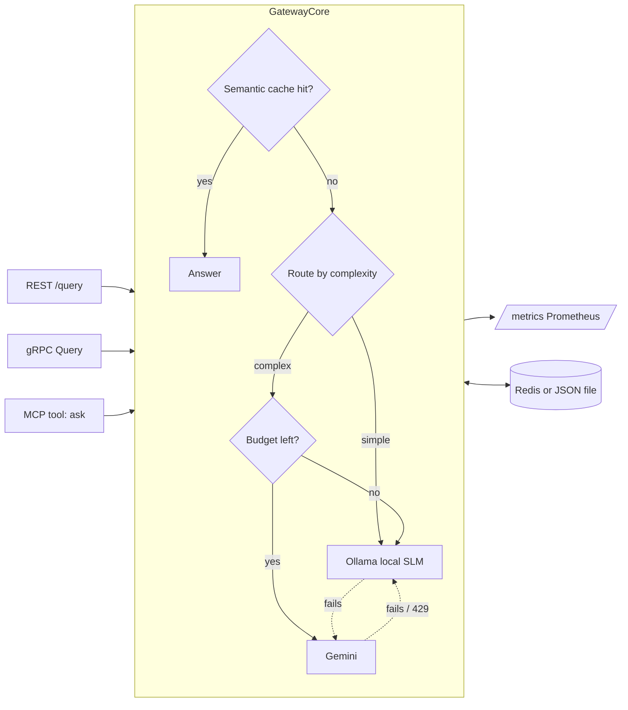

# Hybrid LLM Router & Semantic Cache Gateway

An AI gateway in Python/FastAPI that sits between your applications and language models. It answers repeat questions from a
**semantic cache**, sends each new prompt to a **local model (Ollama)** or a **cloud model (Gemini)** by complexity, **fails
over both ways** when a provider is down or rate-limited, and enforces a **daily cloud budget**. One core serves three front
ends: **REST**, **gRPC** and an **MCP tool server**, with **Prometheus metrics**, a **Redis-backed shared cache**, Docker,
Kubernetes manifests and CI.



## Features

| | |
|---|---|
| **Semantic cache** | Embeds each prompt (Ollama `nomic-embed-text`) and matches by cosine similarity (default ≥ 0.95). Embeddings are one normalised matrix, so a lookup is a single matrix-vector product. |
| **Complexity router** | Length and keyword rules (`solve`, `design`, `analyze` …) pick local or cloud in microseconds. |
| **Two-way failover** | Local down → Gemini. Gemini fails or returns HTTP 429 → local. Calls with `force_cloud` fail loudly (502) instead of silently downgrading. |
| **Cost policy** | `DAILY_BUDGET_USD`: when the day's cloud spend is used up, complex prompts are answered locally (`local_slm_budget`) and `force_cloud` calls get HTTP 429 / gRPC `RESOURCE_EXHAUSTED`. Resets at UTC midnight. |
| **gRPC** | `proto/gateway.proto`: `Query` and `Health`, same behaviour as REST (budget → `RESOURCE_EXHAUSTED`, provider failure → `UNAVAILABLE`). |
| **MCP tool server** | `python -m app.mcp_server` exposes `ask` and `cache_stats` to any MCP client (Claude Desktop, IDEs, agents). |
| **Observability** | `/metrics` (Prometheus): requests and latency by source, cache hit/miss, tokens, cost, provider errors, budget left. `/budget` shows today's spend. |
| **Shared cache** | `CACHE_BACKEND=redis` keeps entries in a Redis hash; every replica searches its own in-memory index and re-reads Redis every few seconds, so an answer cached by one pod is served by the others. A Redis outage degrades to cache misses, never errors. |
| **Safe writes** | Cache writes are serialised and the JSON file is replaced atomically, so concurrent requests can't corrupt it. |
| **Key hygiene** | The Gemini key is sent in the `x-goog-api-key` header, never in the URL, so it can't leak into access logs or error messages. |

## Measured

`python scripts/bench.py` (developer laptop, stubbed model providers, so these measure the gateway's own code):

| | before | now |
|---|---|---|
| Cache lookup over 5,000 entries × 768 dimensions | 1,334 ms (Python loop, blocked the event loop) | **1.04 ms** (matrix search) |
| 400 requests, 100 in flight, 20 ms stub model | n/a | 0.20 s total (serial would be 8 s), p95 46 ms |

A cache hit end to end is the embedding call to Ollama plus the ~1 ms lookup; use `audit_benchmark.py` against a running
gateway to measure it on your hardware.

## Quick start

```bash
python -m venv .venv && . .venv/bin/activate        # Windows: .venv\Scripts\activate
pip install -r requirements-dev.txt
python scripts/gen_proto.py                          # generates the gRPC stubs into app/
cp .env.example .env                                 # add GEMINI_API_KEY
uvicorn app.main:app --port 8000                     # REST on :8000, gRPC on :50051
python -m pytest -q                                  # 54 tests
```

Local model (optional, enables the local route and the semantic cache): `ollama pull llama3 && ollama pull nomic-embed-text`.
The cache needs Ollama for embeddings; without it every request is a miss and goes to Gemini.

### Docker and Kubernetes

```bash
docker compose up --build                            # gateway + Redis (cloud model only)
docker compose --profile local-llm up --build        # + Ollama

kubectl create secret generic gateway-secrets --from-literal=GEMINI_API_KEY=...
kubectl apply -f k8s/                                # Deployment (2 replicas, probes, limits, non-root), Service,
                                                     # HPA (2-8 pods at 70% CPU), Redis + PVC
```
Point `OLLAMA_BASE_URL` in `k8s/gateway.yaml` at your Ollama. The manifests are schema-validated in CI.

### Using it

```bash
curl -s localhost:8000/query -H 'content-type: application/json' -d '{"prompt": "what is raft?"}'
curl -s localhost:8000/metrics | grep gateway_
```
```python
import grpc
from app import gateway_pb2, gateway_pb2_grpc
stub = gateway_pb2_grpc.GatewayStub(grpc.insecure_channel("localhost:50051"))
print(stub.Query(gateway_pb2.QueryRequest(prompt="what is raft?")).source)
```
MCP client config:
```json
{"mcpServers": {"gateway": {"command": "python", "args": ["-m", "app.mcp_server"], "cwd": "/path/to/hybrid-llm-gateway"}}}
```

## Configuration

| Variable | Default | |
|---|---|---|
| `GEMINI_API_KEY` | | cloud model |
| `OLLAMA_BASE_URL`, `OLLAMA_MODEL`, `OLLAMA_EMBED_MODEL` | `localhost:11434`, `llama3`, `nomic-embed-text` | local model |
| `SIMILARITY_THRESHOLD` | `0.95` | cache match |
| `COMPLEXITY_THRESHOLD_CHARS` | `150` | longer prompts go to the cloud |
| `CACHE_BACKEND` | `file` | `file` or `redis` |
| `REDIS_URL`, `CACHE_REFRESH_SECONDS` | `redis://localhost:6379/0`, `5` | shared cache |
| `DAILY_BUDGET_USD` | `0` (off) | cloud spend cap per UTC day |
| `GRPC_PORT` | `50051` | `0` turns gRPC off |

## REST endpoints

`POST /query` · `GET /health` · `GET /metrics` · `GET /budget` · `GET /cache/stats` · `GET /api/cache` ·
`DELETE /api/cache/{id}` · `POST /cache/clear` · `/` admin dashboard · `/docs` OpenAPI

`source` in a response is one of `cache (similarity: …)`, `local_slm`, `cloud_llm`, `cloud_llm_forced`,
`cloud_llm_fallback`, `local_slm_fallback`, `local_slm_budget`.

## Layout

```text
app/
  core.py            routing, fallback, budget policy, metrics (shared by every front end)
  main.py            REST API + dashboard        grpc_server.py   gRPC front end
  mcp_server.py      MCP tools                   metrics.py       Prometheus series
  cache.py           semantic cache (file + Redis)   budget.py     daily spend cap
  router.py          complexity rules            services/        Ollama and Gemini clients
proto/gateway.proto  gRPC contract               scripts/         gen_proto.py, bench.py
k8s/  Dockerfile  docker-compose.yml  .github/workflows/ci.yml
tests/               54 tests: routing, fallbacks, budget, cache, Redis replicas, gRPC, MCP, deploy files
```

## Limits

* Semantic search is exact (all entries compared), which is fast to tens of thousands of entries; beyond that move to a
  vector index.
* The router is rule-based, not learned.
* Cost is estimated from Gemini 1.5 Flash list prices; update `cloud_service.py` if you change model.
